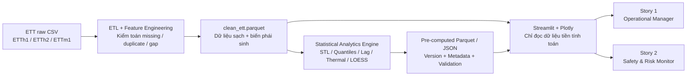

# ETT Power Grid Operational Management & Thermal Safety Visual Analytics Dashboard


[](LICENSE)

**`ETT_GRID_VIS_2026` · Trực quan hóa dữ liệu & phân tích thống kê ứng dụng · CPU-only**

> **Trạng thái đã kiểm tra — 28/10/2026:** Repository hiện có tài liệu điều hành và khung thư mục, chưa có pipeline, artifacts hoặc dashboard chạy được. Các sơ đồ, schema và CLI bên dưới mô tả **kiến trúc đích**, không phải tính năng đã bàn giao. Badge công nghệ không chứng nhận dependency đầy đủ hoặc kiểm thử thành công.

| Tầng thông tin | Dành cho | Nội dung |
|---|---|---|
| [1 · Tổng quan](#overview) | Người đọc mới, bên liên quan nghiệp vụ | Bài toán, hai User Stories, luồng dữ liệu |
| [2 · Kiến trúc & hợp đồng](#architecture) | Nhóm ETL, phân tích và giao diện | Workspace, quyền thao tác, dữ liệu, artifacts, chuẩn thị giác |
| [3 · Thực thi & quản trị](#operations) | Người phát triển, PM và QA | Môi trường, CLI, RACI/WBS, nghiệm thu, tài liệu nguồn |

---

<a id="overview"></a>
## Tầng 1 — Tổng quan | Overview first

### 1.1. Bài toán và tuyên ngôn giải pháp

Dữ liệu nhiệt độ dầu máy biến áp (**OT — Oil Temperature**) và sáu nhánh phụ tải ETT chứa các chu kỳ vận hành, biến thiên theo thời gian và mối liên hệ có độ trễ. Bảng số liệu hoặc nhiều đường khác thang đo chồng lên nhau gây khó khăn khi so sánh tải, tìm giai đoạn OT cao và đặt một biến cố vào ngữ cảnh lịch sử.

**Giải pháp v2.0:** Tổ chức một Statistical Analytics Engine tiền tính toán để chuyển dữ liệu lịch sử thành hai góc nhìn tương tác: **lập kế hoạch vận hành** và **tra cứu rủi ro nhiệt**. Trọng tâm là diễn giải dữ liệu, không xây dựng mô hình dự báo hay hệ thống điều khiển thiết bị.

> **Giới hạn diễn giải:** 85°C và 95°C là ngưỡng phân tích của dự án, không phải tiêu chuẩn kỹ thuật phổ quát. Dashboard không phải hệ thống giám sát trực tiếp hoặc an toàn được chứng nhận. Tương quan, LOESS và Z-score chỉ hỗ trợ hình thành giả thuyết; không chứng minh nhánh tải là nguyên nhân sự cố.

### 1.2. Hai User Stories cốt lõi

| Vai trò | User Story | Góc nhìn / tương tác đích |
|---|---|---|
| **US-01 · Operational Manager** — Nhà quản lý vận hành | **Là** nhà quản lý vận hành, **tôi muốn** quan sát chu kỳ phụ tải ngày/mùa, tỷ trọng tải hữu ích so với tải vô ích qua ba cấp điện áp và độ trễ liên hệ với OT, **để** hỗ trợ điều độ công suất và lập lịch bảo dưỡng. | Calendar Heatmap; STL panels; Hourly Quantile Fan; 100% Stacked Bar; Lag Heatmap. Lọc dataset, mùa và thời gian. |
| **US-02 · Safety & Risk Monitor** — Nhân viên giám sát an toàn | **Là** nhân viên giám sát an toàn, **tôi muốn** tra cứu OT tiệm cận/vượt 85°C và 95°C, xem thời lượng cùng áp lực nhiệt tích lũy, rồi đối chiếu sáu nhánh tải, **để** ưu tiên kiểm tra và khoanh vùng giả thuyết bất thường. | OT threshold line/shading; Barcode/Rug; sáu Synchronized Small Multiples; Joint Scatter + LOESS; Boxplots theo chế độ nhiệt. Đồng bộ trục X, zoom và lựa chọn cửa sổ. |

Trong README, “vô công/hao phí” là cách gọi nghiệp vụ của **Unuseful Load**; chưa đủ bằng chứng để đồng nhất với công suất phản kháng đã hiệu chuẩn. **Thời lượng quá nhiệt** đo bằng giờ; **Degree-Hours** đo bằng °C·h, không thay thế cho thời lượng.

### 1.3. Kiến trúc dữ liệu đầu cuối — đích triển khai



**Ranh giới tính toán:** ETL và Engine chạy ngoài UI. Giao diện chỉ nạp artifacts, lọc/lấy lát dữ liệu nhẹ và dựng biểu đồ; không chạy STL, phân vị, tương quan trễ, LOESS hoặc tính risk nặng trong luồng tương tác. Cache phải phụ thuộc nguồn/phiên bản artifacts. **SLA mục tiêu: load/render/filter <2 giây**, chưa có số đo xác nhận.

| Thành phần phân tích | Kết quả và quy tắc cốt lõi |
|---|---|
| **STL Decomposition** | Tách observed thành trend + seasonal + residual; chu kỳ ngày là 24 mẫu cho ETTh và 96 mẫu cho ETTm1. |
| **Historical Empirical Quantile Bands** | Theo giờ/mùa: IQR 50% = Q25–Q75; 80% = Q10–Q90; 95% = Q2.5–Q97.5; median và mean là hai đường phân biệt. |
| **Lag Cross-Correlation 0–12h** | Pearson/Spearman giữa load(t) và OT(t+k giờ); lag dương nghĩa tải đi trước OT; căn theo timestamp, không nối mù qua gap. |
| **Thermal events / Degree-Hours** | Trích xuất riêng từng ngưỡng OT ≥85°C và ≥95°C; đo duration, peak và tích lũy phần nhiệt vượt ngưỡng. |
| **LOESS + Z-score** | Khảo sát quan hệ phi tuyến và độ lệch tương đối trong cửa sổ biến cố; tiền tính ngoài UI, cần thống nhất schema bổ sung trước triển khai. |

---

<a id="architecture"></a>
## Tầng 2 — Kiến trúc & hợp đồng | Zoom and filter

### 2.1. Workspace: hiện trạng khác với kiến trúc đích

**Chú giải:** `[HIỆN CÓ]` = đường dẫn đã tồn tại, không đồng nghĩa đã có implementation; `[ĐÍCH]` = chưa tồn tại. Cây rút gọn bỏ qua cache và `.gitkeep`.

```text
data_visualization_project/
├── AGENTS.md                         [HIỆN CÓ] Quy chuẩn agent / hợp đồng v2.0
├── README.md                         [HIỆN CÓ] Tài liệu định hướng này
├── LICENSE                           [HIỆN CÓ] MIT
├── requirements.txt                  [HIỆN CÓ] 🟡 Dependency được khai báo
├── .gitignore                        [HIỆN CÓ] Loại trừ môi trường / secrets / cache
├── .venv/                            [HIỆN CÓ] Môi trường cục bộ, không phân phối
├── data/
│   ├── raw/                          [HIỆN CÓ] 🔴 Chưa có CSV ETT
│   └── processed/                    [ĐÍCH]    🟢 clean_ett.parquet
├── docs/                             [HIỆN CÓ]
│   ├── project_charter/              [HIỆN CÓ] 🔴 PDF / Excel / HTML điều hành
│   ├── references/                   [HIỆN CÓ] 🔴 Tài liệu nguồn lưu trữ
│   ├── dev_logs/                     [HIỆN CÓ] 🟢 Nhật ký phát triển, hiện là khung
│   └── bug_fixes/, reports/, thesis/  [HIỆN CÓ] Khung tài liệu
├── src/
│   ├── data/                         [HIỆN CÓ] 🟢 Chưa có mã nguồn .py
│   ├── analysis/                     [ĐÍCH]    🟢 Statistical Engine
│   └── visuals/                      [ĐÍCH]    🟢 Hai góc nhìn / Plotly charts
├── scripts/                          [HIỆN CÓ] 🟢 Chưa có CLI nguồn
├── notebooks/                        [HIỆN CÓ] 🟢 Chưa có notebook phân tích
├── output/                           [HIỆN CÓ] Khung đầu ra
│   └── artifacts/                    [ĐÍCH]    🟢 Artifacts tiền tính toán
├── tests/                            [HIỆN CÓ] 🟢 Chưa có test nguồn
├── audit/                            [ĐÍCH]    🟢 Bằng chứng visual QA / hiệu năng
└── app.py                            [ĐÍCH]    🟡 Entry point Streamlit
```

| Vùng | Quyền thao tác | Ràng buộc |
|---|---|---|
| 🔴 **Red — Read-only** | Đọc `data/raw/`, `docs/project_charter/`, `docs/references/` | Không sửa/xóa/đổi tên/ghi đè dữ liệu hoặc tài liệu gốc. Thu thập raw cần quy trình riêng được thống nhất. |
| 🟡 **Amber — Confirmation required** | `requirements.txt`, `app.py`, cấu hình triển khai | Phải có xác nhận trước khi tạo/sửa; không tự cài hoặc nâng dependency. |
| 🟢 **Green — Autonomous** | `src/data/`, `src/analysis/`, `src/visuals/`, `scripts/`, `notebooks/`, dữ liệu dẫn xuất, `tests/`, `audit/`, `docs/dev_logs/` | Tự triển khai trong phạm vi task và contract; giữ thay đổi của người khác. |

Quy tắc đầy đủ ở [AGENTS.md](AGENTS.md): làm trên feature branch, không tự commit/push, không đọc/in secrets và không biến kế hoạch thành tuyên bố đã hoàn thành.

### 2.2. Dữ liệu ETT & thang đo Stevens

| Dataset | Độ phân giải | Quy tắc phân tích |
|---|---|---|
| `ETTh1`, `ETTh2` | 1 giờ / mẫu | Xử lý riêng từng dataset; lag k giờ tương ứng k mẫu khi chuỗi liên tục. |
| `ETTm1` | 15 phút / mẫu | Lag k giờ tương ứng 4k mẫu khi chuỗi liên tục; không trộn với độ phân giải giờ. |

**Đơn vị quan sát:** một mẫu thời gian trong một dataset. Nguồn có **8 cột: `date` + 7 biến định lượng**; không phải bảy cột bao gồm thời gian. Số dòng, khoảng ngày, missing và extrema phải được kiểm kê trên tệp thực có, không suy từ mô tả tài liệu.

| Trường nguồn | Ý nghĩa | Phân loại / Stevens | Mã hóa phù hợp |
|---|---|---|---|
| `date` | Thời điểm quan sát | Temporal; khoảng cách thời gian có ý nghĩa, không có gốc tỉ lệ tuyệt đối | Vị trí X liên tục; calendar cells |
| `HUFL` | High Useful Load — tải hữu ích cao áp | Định lượng; thang tỉ lệ theo mô tả nghiệp vụ, cần xác minh zero/đơn vị nguồn | Vị trí Y; bar; facet cao áp |
| `HULL` | High Unuseful Load — tải vô ích cao áp | Định lượng; tỉ lệ có điều kiện xác minh như trên | Bar ghép/cặp; tỷ trọng khi hợp lệ |
| `MUFL` | Middle Useful Load — tải hữu ích trung áp | Định lượng; tỉ lệ có điều kiện xác minh như trên | Vị trí Y; facet trung áp |
| `MULL` | Middle Unuseful Load — tải vô ích trung áp | Định lượng; tỉ lệ có điều kiện xác minh như trên | Bar ghép/cặp; tỷ trọng khi hợp lệ |
| `LUFL` | Low Useful Load — tải hữu ích hạ áp | Định lượng; tỉ lệ có điều kiện xác minh như trên | Vị trí Y; facet hạ áp |
| `LULL` | Low Unuseful Load — tải vô ích hạ áp | Định lượng; tỉ lệ có điều kiện xác minh như trên | Bar ghép/cặp; tỷ trọng khi hợp lệ |
| `OT` | Nhiệt độ dầu, °C | Định lượng / **Interval**; 0°C không phải không có nhiệt | Vị trí Y; line; histogram; boxplot |

Các trường dẫn xuất: `dataset` là nominal; `thermal_regime` là ordinal (Normal → Warning → Critical, Unknown tách riêng); `duration_hours` và `degree_hours` là đại lượng tỉ lệ. Không tự gán MW/MVar cho tải hoặc diễn giải “40°C nóng gấp đôi 20°C”.

### 2.3. Artifact contracts — giao diện ETL / Engine / UI

> **Hợp đồng đã đặc tả, artifacts chưa được sinh.** Dùng năm tên chuẩn dưới đây theo [AGENTS.md](AGENTS.md), thay vì tạo thêm alias hoặc tự đổi định dạng giữa producer và consumer.

| Artifact chuẩn | Producer → Consumer | Grain / khóa | Trường chính và ràng buộc |
|---|---|---|---|
| `data/processed/clean_ett.parquet` | ETL → Engine + UI | Một mẫu; `dataset + timestamp` | `OT`, sáu tải, `total_useful_load`, `total_unuseful_load`, `reactive_ratio`, `thermal_regime`, `is_imputed`; thời gian tăng dần, không trùng trong dataset. |
| `output/artifacts/load_profiles_stl.parquet` | Engine → UI Story 1 | Long-form; `record_type=stl/profile` | STL: `dataset + variable + timestamp`, observed/trend/seasonal/residual. Profile: `dataset + variable + season + hour`, mean/median/std/sample_count. Cột không áp dụng = null. |
| `output/artifacts/quantile_bands.parquet` | Engine → Fan Chart | `dataset + variable + season + hour` | `sample_count`, `mean`, `q025`, `q10`, `q25`, `q50`, `q75`, `q90`, `q975`; đủ 24 bins, thiếu mẫu → thống kê null. |
| `output/artifacts/thermal_breach_events.parquet` | Engine → UI Story 2 | Một đợt liên tục theo ngưỡng; `dataset + event_id` | `threshold_c`, `thermal_regime`, `start_timestamp`, `end_timestamp`, `duration_hours`, `peak_ot`, `degree_hours`, `sample_count`, `is_right_censored`. |
| `output/artifacts/lag_correlation_matrix.json` | Engine → Lag Heatmap | Envelope nhiều dataset/mùa/phương pháp | `records` chứa dataset/season/method, thứ tự sáu tải, lags 0..12, ma trận correlation và sample_counts cùng kích thước 6×13. |

<details>
<summary><strong>Chi tiết theo nhu cầu: dtype, thời gian, chất lượng và công thức</strong></summary>

- **Dtype:** Parquet dùng string, `datetime64[ns]`, `float32`, `int32`, bool; nullable theo schema. JSON dùng `null`, không ghi NaN/Infinity. Không thêm cột ngoài contract nếu chưa đồng bộ producer/consumer/tests.
- **Timestamp:** đổi `date` thành `timestamp`; chưa biết timezone thì giữ timestamp không gán múi giờ và ghi `timezone=unknown`. Chuỗi trao đổi RFC3339 chỉ dùng offset đã xác minh; không tự thêm `Z`.
- **Metadata:** schema version 2.0, dataset/source hash, tham số, seed 2026 và thời điểm sinh. Parquet lưu metadata; JSON tuân thủ envelope quy định trong AGENTS. Kiểm định trước khi ghi tệp tạm và thay thế nguyên tử.
- **Biến phái sinh:** `total_useful_load = HUFL + MUFL + LUFL`; `total_unuseful_load = HULL + MULL + LULL`; `reactive_ratio = total_unuseful_load / total_useful_load`, mẫu số ≤0 → null. Tải âm hoặc mẫu số cặp ≤0 không được ép thành tỷ trọng 100% hợp lệ.
- **Chế độ nhiệt:** Normal khi OT<85; Warning khi 85≤OT<95; Critical khi OT≥95; OT thiếu → Unknown. Tên chế độ là nhãn dự án, không phải xác nhận an toàn thiết bị.
- **Quantiles:** phải tăng không giảm, dải lồng nhau. Q5–Q95 là **90%**, không phải 95%. Dải lịch sử mô tả phân phối mẫu, không phải confidence interval của mean hay prediction interval.
- **Thermal:** `degree_hours = Σ max(OT − threshold_c, 0) × Δt_hours`, với Δt=1h hoặc 0.25h trên hỗ trợ mẫu hợp lệ. Sự kiện dùng `[start,end)`; không nối qua missing/gap, không kéo dài mẫu cuối chưa biết hỗ trợ; đánh dấu right-censored khi cần.
- **Hai ngưỡng:** đợt ≥95 có thể nằm trong đợt ≥85; không cộng chồng thời lượng hoặc Degree-Hours giữa hai ngưỡng. Không có breach → bảng rỗng đúng dtype; không sửa nhiệt độ để tạo demo.
- **Lag:** `r(k) = corr(load(t), OT(t+k giờ))`; Pearson/Spearman, hệ số trong [-1,1] hoặc null; số cặp hợp lệ ≥0. Constant/thiếu cặp không được biến thành hệ số 0.
- **Missing:** audit duplicate/gap trước xử lý, nội suy chỉ theo policy khoảng ngắn; giữ đỉnh OT hợp lệ. Thiếu mẫu phải có ngữ cảnh chất lượng, không suy ra Normal.
- **LOESS / Z-score:** chưa có artifact bổ sung được thống nhất; không lách ranh giới bằng cách tính trực tiếp trong UI. Biến constant có Z-score không xác định, không mặc định bằng 0.

</details>

### 2.4. Nền tảng thiết kế thị giác

| Nguyên lý | Áp dụng có thể kiểm tra |
|---|---|
| **Munzner — What / Why / How** | Mỗi chart ghi dữ liệu đầu vào, câu hỏi theo User Story, encoding và interaction; ưu tiên position/length khi so sánh định lượng. |
| **Tufte — Data-Ink** | Bỏ viền hộp, 3D, bóng và lưới phụ; lưới chính `#E2E8F0`. Giữ đơn vị, ngưỡng, cỡ mẫu và ngữ cảnh. Action Title phải được dữ liệu trong bộ lọc hỗ trợ, không bịa insight. |
| **Gestalt — Proximity / Alignment** | Nhóm KPI liên quan; sáu small multiples căn thẳng dưới OT, cùng trục thời gian, zoom và selection. |
| **Gestalt — Enclosure / Similarity** | Dải bao cho quantiles và events; nhất quán màu tải hữu ích/vô ích; không chồng bảy đường khác thang đo. |
| **Pre-attentive pop-out** | Chỉ làm nổi bật cảnh báo/biến cố phù hợp; thêm nhãn, dash hoặc shape, không dựa duy nhất vào màu. |
| **Accessibility — mục tiêu WCAG AA** | Kiểm tra tương phản chữ thường ≥4.5:1 trên nền thực tế; thử grayscale, deuteranopia/protanopia. Không tự gắn nhãn “đã đạt” khi chưa audit. |

| Vai trò ngữ nghĩa | Màu / encoding |
|---|---|
| OT / tải hữu ích / dữ liệu bối cảnh | Navy `#1E3A8A` / Teal `#0D9488` / Slate `#64748B` |
| Warning / Critical | Amber `#D97706` / Crimson `#DC2626`, kèm ngưỡng và nhãn; không dùng cặp đỏ–xanh lá cạnh tranh |
| Bands 50% / 80% / 95% | Blue `#93C5FD`, alpha 0.28 / 0.20 / 0.14; vẽ dải rộng trước, median/mean không bị che |

---

<a id="operations"></a>
## Tầng 3 — Thực thi & quản trị | Details-on-demand

### 3.1. Môi trường và khả năng tái lập

**Prerequisites:** Git, Windows PowerShell và **Python 3.11+** theo baseline trong AGENTS. Interpreter cục bộ đã kiểm tra là Python 3.11.1; Python 3.10 chưa được xác nhận hỗ trợ. Không cần phần cứng tăng tốc chuyên dụng.

**Stack đích:** Pandas, NumPy, SciPy, Statsmodels, Plotly, Streamlit, Seaborn, Missingno; Parquet cần backend được duyệt như PyArrow. Đây là danh mục kiến trúc, **không phải danh sách đã khai báo đầy đủ để cài**.

```powershell
# Chạy tại repository root; dùng môi trường hiện có, không ghi đè .venv.
Set-Location 'F:\Study Materials\specialized_subject\Visualization\Visualization_gr\data_visualization_project'
. .\.venv\Scripts\Activate.ps1
python -V
python -c "import sys; print(sys.executable)"
python -m pip list
```

Chỉ khi thiết lập trên máy mới **chưa có `.venv`**, tạo môi trường rồi kích hoạt:

```powershell
py -3.11 -m venv .venv
. .\.venv\Scripts\Activate.ps1
# Cài đúng manifest đã duyệt; không tự thêm/nâng package.
python -m pip install -r requirements.txt
```

| Hiện trạng dependency | Hệ quả |
|---|---|
| `requirements.txt` chỉ có `python-dotenv`, `kaggle`, `pandas`, chưa pin phiên bản | Cài manifest hiện tại chưa đủ để chạy kiến trúc đích và chưa bảo đảm tái lập phiên bản chính xác. |
| Môi trường cục bộ có một số thư viện ngoài manifest, nhưng thiếu Statsmodels và Missingno | Package “đang có trên máy” không phải dependency đã được phê duyệt cho dự án. |
| Chưa có mã ETL/Engine/UI, dữ liệu nguồn hay artifacts | Không có quickstart end-to-end chạy được ở thời điểm khảo sát. |

**Bước mở khóa:** nhóm phê duyệt manifest/backend Parquet và phiên bản; thực hiện quy trình thu thập dữ liệu có provenance; triển khai ETL, Engine, contracts/tests; chỉ sau đó tạo entry point UI có xác nhận. Không tự cài package để vượt lỗi. Không đọc hoặc đưa nội dung `.env` vào log/commit.

### 3.2. CLI workflow — hợp đồng đích, chưa phải quickstart hoạt động

Các lệnh dưới đây chạy sau khi kích hoạt `.venv`, tại root. **Chưa chạy các CLI đích khi script chưa tồn tại**; khi triển khai phải kiểm tra `--help`, input và schema trước.

| Bước | Lệnh PowerShell | Trạng thái / điều kiện |
|---|---|---|
| 1 · ETL | `python scripts/preprocess_ett.py --data ETTh1 --out data/processed/clean_ett.parquet` | **ĐÍCH:** chưa có script/CSV; giữ raw bất biến, xử lý riêng dataset. |
| 2 · Statistical Engine | `python scripts/run_statistical_engine.py --input data/processed/clean_ett.parquet --out output/artifacts` | **ĐỀ XUẤT:** chưa có script; tiền tính artifacts ngoài UI. |
| 3 · Dashboard | `python -m streamlit run app.py` | **ĐÍCH / AMBER:** chưa có entry point; cần artifacts và phê duyệt tạo/sửa. |
| 4 · Tests | `python -m pytest tests/ -v --tb=short` | Runner có trong `.venv` cục bộ, chưa có test nguồn; thu thập 0 tests không phải PASS. |

Khi bổ sung nhiều dataset vào một tệp clean, ETL phải bảo toàn khóa `dataset + timestamp`; không chạy lặp CLI một cách mù quáng để ghi đè kết quả dataset trước. Chính sách ghi/ghép cần được kiểm thử khi hiện thực hóa CLI.

<details>
<summary><strong>Checklist xử lý khi chưa chạy được</strong></summary>

1. Xác nhận đúng interpreter `.venv`; so sánh package với manifest đã duyệt.
2. Kiểm tra script/input thực sự tồn tại; `.pyc` và cache không thay thế mã nguồn.
3. Nếu thiếu package/backend: báo **BLOCKED**, xin duyệt thay vì tự cài.
4. Nếu thiếu dataset hoặc provenance: không sinh dữ liệu giả như kết quả thực nghiệm; fixture tổng hợp chỉ dùng trong tests, ngoài raw.
5. Nếu thiếu app/artifacts: báo SLA **N/A**, không suy diễn cache sẽ tự bảo đảm <2s.

</details>

### 3.3. Nhân sự, WBS và RACI

| Thành viên | Vai trò | Trách nhiệm chính |
|---|---|---|
| **A** | Data & ETL Lead | Thu thập, chất lượng dữ liệu, ETL, feature engineering và schema clean. |
| **B** | Statistical & Domain Analytics Lead | STL, quantiles, lag correlation và phân tích sự kiện nhiệt. |
| **C** | UI Lead — Story 1 | Góc nhìn quản lý vận hành và các biểu đồ liên quan. |
| **D** | UI Lead — Story 2 | Góc nhìn tra cứu nhiệt, events và small multiples. |
| **E** | PM & Visual QA Auditor | Điều phối, wireframe, audit thị giác/tiếp cận và hồ sơ bàn giao. |

**RACI:** R = Responsible (thực thi), A = Accountable (chịu trách nhiệm cuối cùng), C = Consulted, I = Informed. Chữ A trong ô RACI khác mã thành viên A ở tiêu đề cột.

| Work Package | Phạm vi / sản phẩm đích | TV A | TV B | TV C | TV D | TV E |
|---|---|---|---|---|---|---|
| **WP01** | Data ingestion, cleaning & feature engineering | R | C | I | I | A |
| **WP02** | Statistical & Domain Analytics Engine | C | R | C | C | A |
| **WP03** | Operational Manager Dashboard — Story 1 | I | C | R | I | A |
| **WP04** | Safety & Risk Monitor Dashboard — Story 2 | I | C | I | R | A |
| **WP05** | App integration, Data-Ink & accessibility QA | C | I | C | C | R/A |
| **WP06** | Governance, reporting & final delivery | C | C | C | C | R/A |

Charter §7 định nghĩa **16 tasks / 6 Work Packages**. Lộ trình tương đối sáu tuần: nền tảng → ETL/EDA → Engine/wireframe → hai UI → tích hợp/QA → bàn giao. Đây là kế hoạch, không phải bằng chứng tiến độ hiện tại; trạng thái trong Charter phải đối chiếu với sản phẩm thực có.

Bảng Excel có **6 nhóm TQH-01..06**, chưa điền người phụ trách/hạn nộp; không tự ánh xạ thành 16 tasks hoặc thay thế RACI Charter. Quyền chịu trách nhiệm theo WP không tự phê duyệt thao tác AMBER của agent.

### 3.4. Definition of Done — cần bằng chứng, không chỉ checklist

- [ ] **1 · Code / types / visual rules:** cú pháp hợp lệ, PEP 8, type hints đầy đủ trong `src/`, `SEED=2026`; constants tập trung; What–Why–How và encoding được đối chiếu.
- [ ] **2 · Unit + smoke tests:** có tests thực sự và PASS; bao phủ STL reconstruction, quantile nesting, lag sign/cadence, missing/constant, thermal boundaries/gaps/right-censoring.
- [ ] **3 · Governance:** raw/tài liệu RED không đổi; AMBER có xác nhận; diff đúng task/branch; không lộ secrets hoặc ghi đè công việc có sẵn.
- [ ] **4 · Contracts:** tên file, keys, dtype, metadata, units, null/empty đúng schema; UI không tính nặng và chỉ đọc artifacts tương thích phiên bản.
- [ ] **5 · SLA + delivery evidence:** load/render/filter <2s trên dữ liệu đại diện, ghi cấu hình và cold/warm cache riêng; visual/accessibility audit, đáp ứng hai US và hồ sơ bàn giao đầy đủ.

**Hiện tại:** chưa có test nguồn để chứng minh runtime; dashboard/SLA/visual audit **BLOCKED hoặc N/A**. Báo cáo giữa kỳ/cuối kỳ, slide, ảnh audit và video demo là sản phẩm cần bàn giao, không phải tệp đã tồn tại. Không có số đo thì không ghi “đạt <2s” hoặc “WCAG compliant”.

### 3.5. Tài liệu điều hành — đọc sâu khi cần

| Nguồn hiện có | Nội dung / cách tra |
|---|---|
| [AGENTS.md](AGENTS.md) | Ranh giới agent, schema chi tiết, commands và checklist v2.0. |
| `docs/project_charter/` — PDF tên kết thúc `Project Charter & Sprint Manual.pdf` | Charter nội dung v2.0; tên tệp còn giữ mã cũ. §1–4: scope/US/methods; §5: sprint; §6: RACI; §7: 16 tasks; §8: QA/DoD. Tên đầy đủ xem AGENTS. |
| [Final Project.pdf](docs/project_charter/Final%20Project.pdf) | Yêu cầu học phần; §1.2: hai User Stories; §1.3: wireframe; yêu cầu giữa/cuối kỳ. |
| [Detailed Tasks — Excel](docs/project_charter/ETT_GRID_VIS_2026_Detailed_Tasks_6_Muc.xlsx) | Sheets `Progress Overview`, `Detailed Tasks`; sáu nhóm TQH và giới hạn diễn giải. |
| [Checklist phân tích / trực quan hóa — HTML](docs/project_charter/bang_phan_cong_data_analytics.html) | Sáu nhóm công việc, lựa chọn biểu đồ, màu sắc và chất lượng dashboard. |

**Wireframe:** chưa có tệp độc lập; tham chiếu Charter §4.2.D (What–Why–How), §7/T0301 và yêu cầu học phần §1.3. Nội dung lưu trữ trong `docs/references/` không tự động trở thành kiến trúc thực thi. Nếu nguồn khác nhau về tên artifacts, dải phân vị hoặc mức độ khẳng định an toàn, dùng hợp đồng v2.0 trong AGENTS và ghi rõ khác biệt; không sửa tài liệu gốc để che xung đột.

### 3.6. Tài liệu khoa học & giấy phép

1. **Munzner, T. (2014).** *Visualization Analysis and Design.* CRC Press. Nền tảng abstraction dữ liệu, tác vụ và thiết kế encoding.
2. **Tufte, E. R. (2001).** *The Visual Display of Quantitative Information* (2nd ed.). Graphics Press. Nền tảng tính toàn vẹn biểu diễn và Data-Ink.
3. **Cleveland, W. S., & McGill, R. (1984).** Graphical perception: Theory, experimentation, and application to the development of graphical methods. *Journal of the American Statistical Association, 79*(387), 531–554. Cơ sở lựa chọn kênh biểu diễn định lượng.

Các mục trên là tham chiếu thư mục theo Charter §9, không có nghĩa đã có bản sách/bài báo tương ứng trong workspace. Nguồn dataset và ngày truy cập cần được ghi vào provenance khi thu thập dữ liệu thực tế.

Mã nguồn repository áp dụng **[MIT License](LICENSE)** — Copyright (c) 2026 Trần Chí Vỹ. Giấy phép mã nguồn không mặc nhiên bao phủ dữ liệu và tài liệu bên thứ ba; kiểm tra điều khoản từng nguồn khi phân phối.