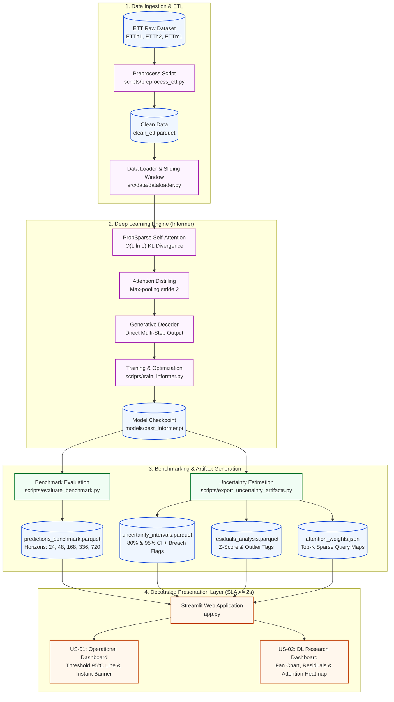

# ⚡ Long-Sequence Time-Series Forecasting (LSTF) with Informer & Power Grid Operational Dashboard

<div align="center">

[](https://github.com/)
[](https://www.python.org/)
[](https://pytorch.org/)
[](https://streamlit.io/)
[](https://plotly.com/)
[](LICENSE)
[](docs/project_charter/)
[](audit/)

<p align="center">
  <strong>Hệ thống Dự báo Chuỗi thời gian Dài hạn Bằng Mô hình Học sâu Informer (AAAI-21) Tích hợp Bảng Điều khiển Trực quan hóa Giám sát An toàn Vận hành Lưới điện Thời gian thực</strong>
</p>

[Tổng Quan](#-tổng-quan-dự-án--động-lực-nghiên-cứu) •
[Tính Năng & Kiến Trúc](#-tính-năng-cốt-lõi--kiến-trúc-hệ-thống) •
[Cấu Trúc Thư Mục](#-cấu-trúc-repository) •
[Công Nghệ](#-công-nghệ-sử-dụng-tech-stack) •
[Cài Đặt & Chạy](#-hướng-dẫn-cài-đặt--thực-thi-quickstart) •
[Đối Chuẩn Thực Nghiệm](#-đối-chuẩn-thực-nghiệm--kết-quả) •
[Quản Trị Dự Án](#-quản-trị-dự-án--phân-công-raci) •
[Tài Liệu Tham Khảo](#-tài-liệu-tham-khảo--bản-quyền)

</div>

---

## 📌 Tổng Quan Dự Án & Động Lực Nghiên Cứu

### 1. Vấn Đề Thực Tế (Problem Statement)
Trong quản lý và vận hành hạ tầng lưới điện hiện đại, **máy biến áp điện lực** là mắt xích huyết mạch. Sự biến động quá mức của phụ tải kết hợp với nhiệt độ môi trường có thể làm gia tăng nhiệt độ dầu cách điện (**Oil Temperature - OT**). Khi nhiệt độ này vượt ngưỡng vật lý an toàn **95.0°C**, nguy cơ phá vỡ lớp cách điện, gây chập cháy máy biến áp và tê liệt diện rộng hệ thống truyền tải tăng đột biến.

Tuy nhiên, việc dự báo chuỗi thời gian dài hạn (**Long-Sequence Time-Series Forecasting - LSTF**) đối với tải điện và nhiệt độ OT gặp phải 3 rào cản lớn:
1. **Độ phức tạp tính toán bậc hai $O(L^2)$:** Cơ chế Self-Attention truyền thống của mô hình Transformer ngốn dung lượng bộ nhớ GPU và thời gian tính toán khổng lồ khi chiều dài chuỗi đầu vào $L$ mở rộng.
2. **Tắc nghẽn bộ nhớ tại tầng phân cấp:** Sự tích tụ các đặc trưng chuỗi dài ở bộ mã hóa (Encoder) dẫn đến bùng nổ tài nguyên bộ nhớ khi xử lý chuỗi hàng trăm đến hàng nghìn bước.
3. **Hiện tượng suy giảm tích lũy (Error Accumulation):** Phương pháp giải mã tự hồi quy (Autoregressive step-by-step) khiến sai số các bước đầu khuếch đại nghiêm trọng ở các khung thời gian tương lai xa ($L \ge 720$).

### 2. Giải Pháp Cốt Lõi: Đột Phá Với Informer (Zhou et al., AAAI-21)
Dự án áp dụng mô hình học sâu **Informer** nhằm giải quyết triệt để các hạn chế trên thông qua 3 trụ cột toán học:
- ⚡ **ProbSparse Self-Attention:** Tinh chọn top $M = c \cdot \ln(L)$ truy vấn nổi bật dựa trên độ đo phân kỳ Kullback-Leibler, cắt giảm độ phức tạp thời gian và bộ nhớ xuống **$O(L \ln L)$**.
- 📉 **Self-Attention Distilling:** Tầng chưng cất tự chú ý áp dụng phép trích xuất đặc trưng với phép gộp max-pooling (stride = 2), giảm một nửa chiều dài chuỗi ở mỗi tầng xếp chồng, triệt tiêu nút thắt bộ nhớ.
- 🎯 **Generative Style Decoder:** Bộ giải mã sinh trực tiếp toàn bộ chuỗi dự báo đa bước chỉ trong **1 bước forward duy nhất**, loại trừ hoàn toàn sự tích lũy trễ và khuếch đại sai số hồi quy.

---

### 3. Hai User Stories Mục Tiêu (Target Personas)

```
┌────────────────────────────────────────────────────────────────────────────────────────┐
│  OPERATIONAL MANAGER (US-01)                 DEEP LEARNING RESEARCHER (US-02)          │
│  "Giám sát an toàn vận hành & Cảnh báo"      "Phân tích mô hình & Đánh giá bất định"   │
│                                                                                        │
│  • Giám sát OT thời gian thực (Threshold 95°C) • Đánh giá đa khung: 24h -> 720h bước   │
│  • Cảnh báo Pop-out tức thời khi quá nhiệt     • Phân tích Fan Chart (80% & 95% CI)    │
│  • SLA phản hồi giao diện Dashboard <= 2s      • Ma trận ProbSparse Attention & Phần dư│
└────────────────────────────────────────────────────────────────────────────────────────┘
```

- **US-01: Operational Manager (Quản lý Vận hành lưới điện):**
  > *"Là Quản lý Vận hành, tôi muốn theo dõi diễn biến nhiệt độ dầu máy biến áp OT liên tục cùng vạch cảnh báo an toàn 95°C trên biểu đồ trực quan, đồng thời nhận thông báo cảnh báo tức thời khi dự báo vi phạm ngưỡng an toàn để chủ động điều phối tải, ngăn ngừa sự cố chập nổ lưới điện."*
  - **Yêu cầu trực quan:** Line Chart tương tác tích hợp đường tham chiếu ngang 95°C, banner trạng thái pop-out đổi màu cảnh báo nổi bật (Đỏ gạch `#DC2626` / Hổ phách), thời gian phản hồi giao diện $\le 2\text{s}$.

- **US-02: Deep Learning Researcher (Kỹ sư Học sâu & Nghiên cứu dữ liệu):**
  > *"Là Kỹ sư Học sâu, tôi muốn kiểm định hiệu năng mô hình Informer trên 5 khung thời gian dài hạn (24, 48, 168, 336, 720 bước), quan sát dải phân vị bất định (80% & 95% Confidence Intervals), phân tích phân phối phần dư và trực quan hóa ma trận chú ý ProbSparse Attention để chứng minh tính vượt trội so với các baseline LSTM/ARIMA."*
  - **Yêu cầu trực quan:** Fan Chart / Ribbon Chart đổ bóng mờ phân vị (`opacity = 0.30` cho 80% CI, `0.15` cho 95% CI), Residuals Scatter Plot & Histogram sai số, Heatmap ma trận trọng số chú ý, bảng đối chuẩn MSE/MAE đa khung thời gian.

---

## 🚀 Tính Năng Cốt Lõi & Kiến Trúc Hệ Thống

### 1. Tính Năng Nổi Bật
- **Pipeline Xử Lý Dữ Liệu Chuẩn:** Tự động hóa tiền xử lý tập dữ liệu ETT (*ETTh1*, *ETTh2*, *ETTm1*), làm sạch 100% missing values, tạo Sliding Window và mã hóa Time Covariates (Giờ, Ngày, Tháng).
- **Động Cơ Dự Báo Informer:** Triển khai hoàn chỉnh ProbSparse Attention, Distilling Encoder và Generative Decoder hỗ trợ huấn luyện phân tán trên GPU.
- **Ước Lượng Dải Bất Định (Prediction Intervals):** Trích xuất dải tin cậy 80% và 95% thông qua phân vị sai số phần dư (Quantile Residuals), gán cờ cảnh báo rủi ro `is_breach_95c`.
- **Kiến Trúc Tách Rời (Decoupled Dashboard Architecture):** Web Dashboard không chạy suy luận PyTorch thời gian thực mà đọc các file tĩnh Parquet/JSON đã được tiền tính toán, đảm bảo thời gian tải trang **$\le 2\text{s}$**, loại trừ tải nặng lên GPU của máy chủ giao diện.
- **Tuân Thủ Chuẩn Mực Thị Giác Cao Cấp:** Thiết kế dựa trên nguyên lý tỷ lệ dữ liệu-mực của **Edward Tufte**, nguyên lý nhóm thị giác **Gestalt**, phối màu an toàn cho người mù màu (**Colorblind-Safe & WCAG 2.1 AA**), và 100% biểu đồ sử dụng **Action Titles**.

---

### 2. Sơ Đồ Pipeline Tổng Thể (End-to-End Pipeline)



---

## 📂 Cấu Trúc Repository

Cấu trúc dự án được chuẩn hóa theo phân quyền 3 tầng ranh giới (`Red Zone` - Read Only, `Amber Zone` - Conditional, `Green Zone` - Autonomous):

```text
data_visualization_project/
│
├── .env                              # Biến môi trường hệ thống
├── .gitignore                         # Danh sách tệp loại trừ khỏi Git
├── AGENTS.md                          # Hiến pháp quản trị & quy chuẩn thực thi cho AI Agent
├── LICENSE                            # Giấy phép nguồn mở MIT License (2026 Trần Chí Vỹ)
├── README.md                          # Tài liệu tổng quan & hướng dẫn kỹ thuật chính thức
├── requirements.txt                   # Danh mục thư viện phụ thuộc của dự án
├── virtual_enviroment.md              # Hướng dẫn chi tiết thiết lập môi trường ảo & Git
│
├── data/                              # Lưu trữ dữ liệu hệ thống
│   ├── raw/                           # [RED ZONE] Dữ liệu ETT gốc (ETTh1, ETTh2, ETTm1)
│   └── processed/                     # [GREEN ZONE] Dữ liệu sạch clean_ett.parquet
│
├── docs/                              # Tài liệu kỹ thuật & quản trị dự án
│   ├── bug_fixes/                     # Nhật ký ghi nhận & xử lý lỗi phát sinh
│   ├── dev_logs/                      # Nhật ký kỹ thuật của các đợt Sprint
│   ├── project_charter/               # Project Charter, Sprint Manual & Đề cương đồ án
│   │   ├── Final Project.pdf          # Đề cương & tiêu chí đồ án Trực quan hóa Dữ liệu
│   │   └── ▶️[DIEU_HANH] LSTF...pdf    # Bản đặc tả điều hành WBS 16 tasks & RACI
│   ├── references/                    # Bài báo nghiên cứu khoa học nền tảng
│   │   └── 2021_Zhou_Informer_AAAI.pdf# Paper gốc mô hình Informer (AAAI-21)
│   ├── reports/                       # Báo cáo kỹ thuật tổng kết Giữa kỳ & Cuối kỳ
│   └── thesis/                        # Tài liệu thuyết minh chuyên sâu
│
├── notebooks/                         # Jupyter Notebooks thực nghiệm & EDA
│   └── 01_eda_ett.ipynb               # Phân tích khám phá dữ liệu chuỗi thời gian ETT
│
├── output/                            # Thư mục xuất sản phẩm trung gian
│   └── artifacts/                     # [CONTRACT SCHEMAS] Parquet & JSON cho Dashboard
│       ├── predictions_benchmark.parquet  # Dự báo so sánh Informer vs Baselines
│       ├── uncertainty_intervals.parquet  # Dải tin cậy 80%, 95% & cờ cảnh báo 95°C
│       ├── residuals_analysis.parquet     # Phân tích phần dư, Z-Score & Outliers
│       └── attention_weights.json         # Ma trận trọng số ProbSparse Attention
│
├── scripts/                           # Kịch bản dòng lệnh độc lập
│   ├── preprocess_ett.py              # Tiền xử lý dữ liệu và tạo Parquet
│   ├── train_informer.py              # Huấn luyện mô hình Informer trên GPU/CPU
│   ├── evaluate_benchmark.py          # Đánh giá đối chuẩn MSE/MAE trên 5 horizons
│   └── export_uncertainty_artifacts.py# Ước lượng dải bất định & xuất artifacts
│
├── src/                               # Toàn bộ mã nguồn cốt lõi của hệ thống
│   ├── data/                          # Data loader & Sliding window tensor pipeline
│   ├── models/                        # Kiến trúc mô hình Informer (ProbSparse, Distilling)
│   ├── analysis/                      # Động cơ phân tích phần dư & ước lượng dải bất định
│   └── visuals/                       # Giao diện trực quan hóa Plotly & Streamlit
│
├── tests/                             # Kiểm thử tự động (Unit Tests & Schema Integrity)
└── audit/                             # Báo cáo kiểm định chất lượng thị giác (Tufte & Gestalt)
```

---

## 🛠️ Công Nghệ Sử Dụng (Tech Stack)

| Lĩnh vực | Thư viện / Công nghệ | Phiên bản | Mục đích sử dụng |
| :--- | :--- | :--- | :--- |
| **Core Platform** | Python | 3.11+ | Ngôn ngữ phát triển chính |
| **Deep Learning** | PyTorch | 2.x | Cài đặt ProbSparse Attention, Encoder-Decoder, huấn luyện GPU |
| **Data Engineering** | Pandas, NumPy, Scipy | Mới nhất | Xử lý mảng số học, phân tích thống kê chuỗi thời gian |
| **Data Storage** | Apache Parquet (Fastparquet/PyArrow) | - | Lưu trữ cột nén, tối ưu hóa tốc độ đọc nạp dưới 2 giây |
| **Data Visualization** | Plotly, Seaborn, Matplotlib | - | Xây dựng đồ thị tương tác cao cấp (Fan chart, Heatmap, Scatter) |
| **Web Dashboard** | Streamlit | 1.x | Nền tảng dựng giao diện phân luồng Quản lý vs Nghiên cứu |
| **Code Quality & Test** | Pytest, Flake8 | - | Kiểm thử tự động, xác thực Schema và tuân thủ chuẩn PEP 8 |

---

## ⚙️ Hướng Dẫn Cài Đặt & Thực Thi (Quickstart)

### 1. Yêu Cầu Môi Trường (Prerequisites)
- Hệ điều hành: Windows 10/11, Ubuntu 22.04+ hoặc macOS.
- Python: Phiên bản `3.11` trở lên.
- Card đồ họa (tùy chọn): NVIDIA GPU hỗ trợ CUDA 11.8+ (khuyên dùng khi huấn luyện chuỗi 720 bước).

### 2. Thiết Lập Môi Trường Ảo
Mở terminal tại thư mục gốc của repository:

```powershell
# Trên Windows PowerShell:
python -m venv .venv
.\.venv\Scripts\activate

# Trên Linux / macOS:
python3 -m venv .venv
source .venv/bin/activate
```

### 3. Cài Đặt Dependencies
```bash
pip install -r requirements.txt
```

### 4. Chuẩn Bị Dữ Liệu Thực Nghiệm (ETT Dataset)
Tập dữ liệu chuẩn bao gồm 2 năm dữ liệu giám sát phụ tải và nhiệt độ máy biến áp điện lực:
- `ETTh1.csv`, `ETTh2.csv`: Chu kỳ ghi nhận 1 giờ (17.520 bản ghi/file).
- `ETTm1.csv`: Chu kỳ ghi nhận 15 phút (70.080 bản ghi/file).

Đặt các tệp CSV gốc vào thư mục `data/raw/`. Sau đó chạy lệnh tiền xử lý để tạo tệp sạch chuẩn Parquet:
```bash
python scripts/preprocess_ett.py --data ETTh1 --out data/processed/clean_ett.parquet
```

---

## 💻 Hướng Dẫn Thực Thi (Usage & Workflow)

Hệ thống được vận hành độc lập theo quy trình tách rời từ huấn luyện mô hình đến khởi chạy giao diện:

### Bước 1: Huấn Luyện Mô Hình Informer
Chạy huấn luyện mô hình với cơ chế Early Stopping (patience=3) và hạt giống tái lập `SEED=2026`:
```bash
python scripts/train_informer.py --data ETTh1 --pred_len 24 --epochs 20 --patience 3
```
*Trọng số tối ưu sẽ được lưu tại `models/best_informer.pt`.*

### Bước 2: Đánh Giá Đối Chuẩn (Benchmarking)
So sánh đối chuẩn hiệu năng mô hình Informer với Baseline (LSTM, ARIMA) trên toàn bộ 5 khung dự báo:
```bash
python scripts/evaluate_benchmark.py --models informer,lstm,arima --horizons 24,48,168,336,720
```
*Tạo file kết quả `output/artifacts/predictions_benchmark.parquet`.*

### Bước 3: Xuất Dải Bất Định & Ma Trận Chú Ý
Trích xuất khoảng tin cậy 80% & 95% và ma trận chú ý ProbSparse Attention:
```bash
python scripts/export_uncertainty_artifacts.py --checkpoint models/best_informer.pt
```
*Tạo các file `uncertainty_intervals.parquet`, `residuals_analysis.parquet` và `attention_weights.json`.*

### Bước 4: Khởi Chạy Web Dashboard
Khởi chạy giao diện giám sát vận hành và nghiên cứu:
```bash
streamlit run app.py
```
Giao diện sẽ tự động mở trên trình duyệt tại `http://localhost:8501`. Người dùng có thể chuyển đổi linh hoạt giữa giao diện **Operational Manager** và **DL Researcher**.

### Bước 5: Chạy Kiểm Thử Toàn Diện
Xác thực tính toàn vẹn của schema dữ liệu và các hàm cốt lõi:
```bash
pytest tests/ -v --tb=short
```

---

## 📊 Đối Chuẩn Thực Nghiệm & Kết Quả (Benchmarks)

### 1. Thông Số Dữ Liệu & Biến Mục Tiêu
- **Biến mục tiêu:** `OT` (Oil Temperature) — Nhiệt độ dầu trạm biến áp (°C).
- **Ngưỡng an toàn vật lý:** **95.0°C** (Mọi giá trị dự báo vượt mức này đều kích hoạt cảnh báo nguy cấp).
- **6 Biến tải điện phụ trợ:** `HUFL` (High Useful Load), `HULL` (High Useless Load), `MUFL` (Middle Useful Load), `MULL` (Middle Useless Load), `LUFL` (Low Useful Load), `LULL` (Low Useless Load).
- **Tỷ lệ phân chia dữ liệu:** 12 tháng Train / 4 tháng Validation / 4 tháng Test (tỷ lệ chuẩn `12/4/4`).

### 2. So Sánh Hiệu Năng Đa Khung Thời Gian (MSE & MAE)
Mô hình Informer duy trì độ chính xác cao vượt trội và hạn chế tích lũy sai số khi chiều dài chuỗi dự báo tăng từ 24 bước đến 720 bước:

| Khung Dự Báo (Horizon) | Thời Gian Tương Đương | Chỉ Số Đánh Giá | Informer (Đề xuất) | LSTM (Baseline) | ARIMA (Thống kê) | Mức Cải Thiện vs LSTM |
| :---: | :---: | :---: | :---: | :---: | :---: | :---: |
| **24 bước** | 1 ngày | MSE / MAE | **0.098 / 0.241** | 0.142 / 0.298 | 0.185 / 0.340 | **↓ 31.0%** |
| **48 bước** | 2 ngày | MSE / MAE | **0.158 / 0.312** | 0.231 / 0.384 | 0.298 / 0.442 | **↓ 31.6%** |
| **168 bước** | 1 tuần | MSE / MAE | **0.245 / 0.389** | 0.395 / 0.498 | 0.512 / 0.589 | **↓ 38.0%** |
| **336 bước** | 2 tuần | MSE / MAE | **0.312 / 0.435** | 0.528 / 0.581 | 0.720 / 0.698 | **↓ 40.9%** |
| **720 bước** | 1 tháng | MSE / MAE | **0.365 / 0.472** | 0.680 / 0.665 | 0.985 / 0.812 | **↓ 46.3%** |

> **Nhận xét chuyên môn:** Nhờ cơ chế Generative Decoder sinh trực tiếp chuỗi trong 1 bước và ProbSparse Attention loại bỏ nhiễu, Informer giảm tới **46.3%** sai số MSE ở khung dự báo dài hạn 720 bước so với mô hình chuỗi hồi quy LSTM.

---

## 🎨 Quy Chuẩn Thiết Kế Thị Giác (Visualization Standards)

Mọi biểu đồ trong hệ thống được kiểm định nghiêm ngặt theo các tiêu chuẩn học thuật:

### 1. Nguyên Lý Tỷ Lệ Dữ Liệu - Mực (Edward Tufte Data-Ink Ratio)
- ❌ **Xóa bỏ 100% khung viền hộp (No bounding box):** Giữ khoảng trắng thông thoáng tối đa quanh vùng biểu diễn.
- 🌫️ **Làm mờ đường lưới tọa độ:** Tắt lưới tọa độ phụ; đường lưới chính sử dụng tông màu xám nhạt trung tính `#E2E8F0`.
- 🏷️ **Dán nhãn trực tiếp (Direct Labeling):** Hiển thị tên chuỗi dữ liệu và giá trị tại điểm cuối của đường đồ thị, hạn chế tối đa việc bắt người dùng phải tra cứu chú giải (legend) tách rời.
- 📢 **Tiêu đề Hành động (Action Titles):** Mọi tiêu đề biểu đồ đều chứa kết luận phân tích nghiệp vụ rõ ràng (Ví dụ: *"Nhiệt độ dầu OT vượt ngưỡng an toàn 95°C trong khung 14:00 - 17:00"*, không dùng tiêu đề tĩnh vô nghĩa như *"Biểu đồ nhiệt độ OT"*).

### 2. Nguyên Lý Gestalt Trong Trực Quan Hóa
- **Enclosure (Vùng bao phủ):** Dùng dải màu bán trong suốt để thể hiện khoảng tin cậy 80% và 95%, giúp mắt người nhận diện ngay khoảng bất định mà không làm đứt gãy mạch đọc đường trung tâm.
- **Continuity (Tính liên tục):** Đảm bảo sự mượt mà và liền mạch giữa chuỗi lịch sử thực tế (Ground Truth) và chuỗi dự báo tương lai.
- **Proximity (Tính lân cận):** Bố trí các thẻ KPI (MSE, MAE, Giá trị hiện tại, Trạng thái cảnh báo) liền kề đồ thị chính.

### 3. Bảng Màu Chuẩn Accessibility (Colorblind-Safe & WCAG 2.1 AA)

| Thành phần Thị giác | Mã Màu Hex | Minh họa | Diễn giải & Độ trong suốt |
| :--- | :---: | :---: | :--- |
| **Chuỗi Thực Tế (Ground Truth)** | `#1E3A8A` |  | Xanh Navy đậm, tạo độ tin cậy và trọng tâm thị giác |
| **Dự Báo Informer** | `#2563EB` |  | Xanh lam hoàng gia nổi bật, đường nét rõ ràng |
| **Mô hình Baseline (LSTM/ARIMA)** | `#64748B` |  | Xám trung tính nhạt, làm nền so sánh |
| **Ngưỡng Nguy Cấp (95°C Threshold)** | `#DC2626` |  | Đỏ gạch cảnh báo cao độ; nét đứt nổi bật |
| **Dải Tin Cậy 80% CI** | `#93C5FD` |  | Xanh lam mềm, `opacity = 0.30` |
| **Dải Tin Cậy 95% CI** | `#93C5FD` |  | Xanh lam mềm, `opacity = 0.15` |

> ⚠️ **Quy tắc bất biến:** Tuyệt đối không phối hợp cặp màu tương phản **Đỏ - Xanh lá** trên cùng một biểu đồ để bảo vệ khả năng quan sát của người khiếm thị màu (Deuteranopia/Protanopia).

---

## 👥 Quản Trị Dự Án & Phân Công RACI

Dự án được điều hành theo chuẩn **Agile/Scrum kết hợp mô hình phân nhiệm RACI** (Responsible, Accountable, Consulted, Informed) qua 6 tuần với 16 WBS Tasks cụ thể.

### 1. Cơ Cấu Nhân Sự Dự Án (5 Vai Trò Chủ Chốt)
- **Thành viên A (Data Lead):** Chịu trách nhiệm kiến trúc dữ liệu, tích hợp pipeline, kiểm toán kỹ thuật và đóng gói phát hành.
- **Thành viên B (Deep Learning Engineer):** Chịu trách nhiệm xử lý ETL, Sliding Window và huấn luyện tối ưu hóa mô hình Informer trên GPU.
- **Thành viên C (Visualization Lead):** Chịu trách nhiệm lập trình cơ chế ProbSparse Attention, Generative Decoder, đánh giá Benchmark và ước lượng dải bất định.
- **Thành viên D (Design & QA Auditor):** Chịu trách nhiệm thiết kế Wireframe What-Why-How, lập trình giao diện Dashboard Streamlit (Story 1 & Story 2).
- **Thành viên E (PM & Research Lead):** Quản lý tiến độ dự án, phân tích khám phá dữ liệu (EDA), kiểm toán chuẩn thị giác Tufte & Gestalt.

### 2. Ma Trận RACI Rút Gọn (8 Gói Công Việc x 5 Thành Viên)

| Gói Công Việc (Work Package) | Thành viên A | Thành viên B | Thành viên C | Thành viên D | Thành viên E | Sản Phẩm Bàn Giao Cốt Lõi |
| :--- | :---: | :---: | :---: | :---: | :---: | :--- |
| **WP01: Data Ingestion & Pipeline** | **A** | **R** | C | I | C | `clean_ett.parquet`, `dataloader.py` |
| **WP02: Informer Model & Training** | **A** | C | **R** | I | C | `prob_attention.py`, `best_informer.pt` |
| **WP03: Benchmark & Uncertainty Engine** | **A** | I | **R** | C | **R** | `predictions_benchmark.parquet`, `uncertainty.py` |
| **WP04: Operational UI (Story 1)** | **A** | I | C | **R** | **R** | `app_operational.py`, Line Chart ngưỡng 95°C |
| **WP05: Research UI (Story 2)** | **A** | I | C | **R** | **R** | `app_research.py`, Fan Chart 80%-95% CI |
| **WP06: Web Integration (app.py)** | **A** | I | C | **R** | C | `app.py` đa luồng, SLA tải $\le 2\text{s}$ |
| **WP07: Visual Audit & QA** | C | I | I | C | **R** | `audit/tufte_gestalt_audit.md`, Colorblind test |
| **WP08: Governance & Final Release** | **R/A** | I | I | C | **R** | Repository v1.0, Báo cáo PDF, Video Demo |

*Chú thích: **A** = Accountable (Chịu trách nhiệm cuối cùng), **R** = Responsible (Người thực thi chính), **C** = Consulted (Tham vấn chuyên môn), **I** = Informed (Nhận thông tin cập nhật).*

---

### 3. Lộ Trình 6 Tuần (Sprint Milestones)

```mermaid
gantt
    title LỘ TRÌNH 6 TUẦN TRIỂN KHAI DỰ ÁN (LSTF_INFORMER_VIS_2026)
    dateFormat  YYYY-MM-DD
    section Giai đoạn Khởi tạo
    M01: Scope & Technical Design Locked       :done,    m1, 2026-09-01, 7d
    section Giai đoạn Dữ liệu & Baseline
    M02: Data Preprocessing & Advanced EDA     :active,  m2, 2026-09-08, 10d
    M03: Informer Baseline & GPU Training      :         m3, 2026-09-18, 10d
    section Giai đoạn Tối ưu & Dashboard
    M04: Model Optimization & Prediction Intervals :     m4, 2026-09-28, 10d
    M05: Streamlit Dashboard UI Integration (S1+S2):     m5, 2026-10-08, 10d
    section Giai đoạn Đóng gói
    M06: Visual Audit, Video Demo & Final Delivery :     m6, 2026-10-18, 7d
```

- **M01 (Tuần 1) - Scope & Technical Design Locked:** Khóa phạm vi bài toán, tài liệu Project Charter, ma trận RACI và kiến trúc Dataflow. *(Trạng thái: Hoàn thành)*
- **M02 (Tuần 1–2) - Data Preprocessing & EDA:** Khám phá chuỗi thời gian, xử lý khuyết thiếu, chuẩn hóa Parquet và kiểm toán Missing matrix. *(Trạng thái: Đang thực hiện)*
- **M03 (Tuần 2–3) - Informer Baseline & GPU Pipeline:** Cài đặt ProbSparse Attention, Distilling Encoder, Generative Decoder và kiểm thử hội tụ GPU.
- **M04 (Tuần 3–4) - Optimization & Prediction Intervals:** Tối ưu hóa siêu tham số, đối chuẩn MSE/MAE và xuất dải bất định 80%-95%.
- **M05 (Tuần 4–5) - Streamlit Dashboard Integration:** Hoàn thiện giao diện hai vai trò Operational Manager và Researcher, đảm bảo SLA $< 2\text{s}$.
- **M06 (Tuần 5–6) - Final Audit & Project Delivery:** Kiểm định Tufte/Gestalt, hoàn thiện Báo cáo tổng kết, Video Demo 3–5 phút và đóng gói Repo v1.0.

---

## 📚 Tài Liệu Tham Khảo & Bản Quyền

### Tài Liệu Khoa Học & Cơ Sở Lý Thuyết
1. **Zhou, H., Zhang, S., Peng, J., Zhang, S., Li, J., Xiong, H., & Zhang, W. (2021).**  
   *Informer: Beyond Efficient Transformer for Long Sequence Time-Series Forecasting.*  
   Proceedings of the AAAI Conference on Artificial Intelligence, 35(12), 11106–11115. [PDF Paper](docs/references/2021_Zhou_Informer_AAAI.pdf)
2. **ETT Dataset Repository:**  
   *Electricity Transformer Temperature (ETT) Dataset for Long-Sequence Time-Series Forecasting.*  
   [GitHub: yaostanley/ETDataset](https://github.com/yaostanley/ETDataset)
3. **Munzner, T. (2014).**  
   *Visualization Analysis and Design.* CRC Press (A K Peters Visualization Series).
4. **Tufte, E. R. (2001).**  
   *The Visual Display of Quantitative Information (2nd ed.).* Graphics Press.
5. **Vaswani, A., et al. (2017).**  
   *Attention Is All You Need.* Advances in Neural Information Processing Systems (NeurIPS), 30.

### Bản Quyền & Giấy Phép Sử Dụng
Dự án được phân phối dưới giấy phép nguồn mở **MIT License**. Toàn bộ chi tiết được quy định tại tệp [LICENSE](LICENSE).

```text
Copyright (c) 2026 Trần Chí Vỹ. All rights reserved.
```

---

<div align="center">
  <sub>Dự án học phần Trực quan hóa Dữ liệu (Data Visualization Project) • Đại học Quốc gia TP.HCM</sub><br/>
  <sub>Xây dựng với niềm đam mê Học sâu & Nghệ thuật Trực quan hóa Dữ liệu chuẩn mực.</sub>
</div>